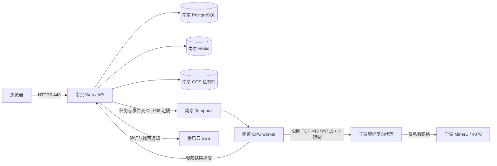

# CL-005 · 内部测试部署与服务接入清单

2026-10-12 · 用户确认的内部测试方案；运行配置、外部能力与实际部署尚待验证。
依据：[ADR-0003](../ADR-0003-identity-and-private-storage.md)、
[ADR-0006](../ADR-0006-deployment-and-async-coordination.md)、[本地验证](validation-record.md)。

## 已确认的配置输入

| 项目 | 用户确认 | 本轮不推定 |
| --- | --- | --- |
| 站点 | cl.hangxiaonet.com，已备案，可配置 DNS | DNS 已指向目标、TLS 已配置或服务已上线 |
| 发件 | 腾讯云 SES，企业资质已有；no-reply.hangxiaonet.com，canlearn@no-reply.hangxiaonet.com；用户报告已审核，验证模板224682、找回224683 | SES 地域/额度/身份验证、审核版本或送达已独立核验 |
| 南京 | 腾讯云 4核8G、COS；业务面、Temporal 和 CPU worker | 实际峰值容量与恢复目标已达成 |
| 宁波 | 16核32G 开发机；长期运行的 4070 主机 24核48G，GPU 主机运行 MinerU/解析入口 | 解析版本/许可、GPU 负载和质量已验收 |
| 网络 | 固定公网 IP，UDP 被封；选用 TCP HTTPS/mTLS 的受限公网接口 | IP 地址、域名证书、代理、ACL 及吞吐已经配置 |
| 注册 | 邮箱/密码＋邀请码＋邮箱验证；码不绑定邮箱、一码一次、7天 | 当前 API 已实现此业务 |
| 链接 | 验证 1小时、找回30分钟 | 库默认自动提供全部一次性、撤销与重放保证 |

## 目标拓扑

图为设计，不代表部署现状。宁波开发机做开发/评测，不持有南京正式业务事实副本。

## 服务接入顺序

| 步骤 | A/B/C/D 分工 | 需要留下的证据 | 当前 |
| --- | --- | --- | --- |
| 1. SES 身份与额度 | A 核验，B 接入 | 控制台实际地域、发件域名/地址验证、DNS、发送额度/计费、用途与最小权限 | 待核验 |
| 2. 邮件模板 | 本轮制作，A 复核；B 后续接入 | 两份模板、审核通过状态、实际 TemplateID、版本/哈希；合成参数及获准收件人的送达记录 | 用户报告已审核，ID已登记；地域、审核版本与送达待补 |
| 3. 认证与邀请契约 | A/B，C 负例，D 体验 | 注册事务、邀请码消费、验证/重发/找回、来源/限流、权限与账户撤销，邮件失败回退 | 隔离兼容性原型通过；应用实现待 CL-007/101 |
| 4. COS 私有配置 | A/B，C 验证 | 桶实际策略、默认私有、IAM 最小权限、版本/生命周期、加密、Range 与清除证据 | SDK 核验完成，实际桶未查 |
| 5. 南京/宁波 TCP 入口 | A/B，C 验证 | 真实公网 IP、GPU 服务域名或 IP SAN、可信 CA、端口/路径/来源 ACL、轮换/吊销与断链恢复 | 本地 mTLS 原型通过，远端未配置 |
| 6. MinerU 与算力 | B/C，A 复核 | 固定版本/镜像摘要/模型、许可证、页/任务契约、GPU显存、负载与重试 | CL-010 接续，未部署 |
| 7. 小规模负载与恢复 | A/B，C 留证，D 验状态 | 4核8G 内存/CPU/磁盘、任务并发、网络费用、备份/隔离恢复与删除水位 | CL-013 与相应功能/恢复卡接续 |

以用户确认的 10 人以内测试规模测容量，先限制解析并发，实测后定数值；
不由人数直接推定 CPU、Temporal、PostgreSQL 或 GPU 峰值一定能承受。

## SES 模板交接

用户已授权制作模板，见 [模板与控制台/API 请求体](email-templates/README.md)。
用户已报告模板审核完成，见 [审核交接记录](email-templates/approval-record.md)。
已登记验证模板 224682、找回模板 224683；SES 地域仍待提供，不将用户报告或本地 payload 当独立查询证据。
企业资质是开通输入，不能替代控制台当前域名/地址/模板可用状态。
SES 的实际处理地域单独核验，南京业务服务器位置不决定 SES 的发送/处理地域。
每次单收件人发送，审批/参数校验在服务端；不发送批量邀请或真实测试邮件，除非用户另行明确指定。

## COS 与公网接入边界

COS 参数使用南京资源，但桶名/IAM、版本状态和保留期限尚未读取。
读取经 API 当前资源授权，文件哈希不授予访问权；版本删除、delete marker、临时对象及备份分开跟踪。
更换 SDK 或访问方式不能改变删后不可读承诺；实际签名/Range/缓存/在途访问由对应下载/删除卡验证。

南京仅公开站点必要入口；DB/Redis/Temporal/UI 保持私有。宁波公网入口只允许南京批准 IP
及持有效客户端证书的服务，代理后只开放已确认的解析路径。模型、客户端或 PDF 内容不能指定任意目标。
服务私钥和实际凭据在受控环境加载，不放入此清单、模板、任务历史或 Git；
固定 IP 不能替代 mTLS，也不能替代逐任务资源授权。

暂未获取服务器登录或腾讯云账号的可用工具访问，不执行远端改动。
本清单提供可操作顺序，实际配置/测试记录必须在相应动作执行后更新。
