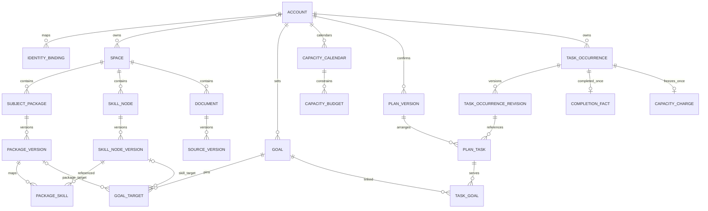

# CL-006a · 概念模型与字段字典

2026-10-16 · 按 #30 评审修订；用户随后确认独立评审通过并授权关闭，R0概念设计已验收；字段不是现有 SQL。

## 归属、学科与版本引用

账户保持稳定业务 ID，认证供应商 subject 在 IdentityBinding 映射；替换认证组件不更换归属。
私有空间由服务端检查账户归属；公共候选与发布空间分离。同名或同哈希不合并所有权。
P0 不引入机构/团队空间；公共编辑权限逐项授予，支持角色不自动取得私有读取权。

学科用 SubjectPackage / SkillNode 数据扩展，408/CET/物理只是样例，不加科目专属列。
Goal 可绑定多包/技能，每条 GoalTarget 必须明确目标种类并锁定版本：
`target_kind=package` 时只填 package_version_id，`skill` 时只填 skill_node_version_id，严格二选一。
包内技能子集用 skill 目标行表示，不使用含义不明的双引用或自由 scope_ref。
PackageSkill 引用真实 SkillNodeVersion.id；PackageVersion / SkillNodeVersion 均有独立 ID 和
稳定实体 ID＋版本号唯一键，不以 SkillNode.version 的模糊字段代替版本实体。

| 引用关系 | 合法条件（接纳事务及读取时复查） |
| --- | --- |
| 私有目标/包 → 同一私有空间版本 | 当前账户有权、资源有效、用途获准 |
| 私有目标/包 → 公共发布版本 | 明确锁定已发布 Release；当前用途获准，撤回后阻断新使用；不获得公共编辑权 |
| 私有空间 A → 私有空间 B | R0 拒绝，即使名称/哈希相同；跨账户复制须合法新建与重新授权 |
| 公共候选/发布包 → 私有版本 | 拒绝，不能用公共映射泄露私有节点 |
| 公共候选/发布包 → 其他公共发布版本 | 需受控编辑身份、用途/权利审核；已发布包变更须新版本/发布审核，候选不得被普通私有计划当已发布资源引用 |

目标、包、技能的版本均保留 space_id / rights_snapshot_id。跨域引用必须满足上表，不靠不可猜测 ID 授权。
混合来源仍按最窄用途/域接纳，私有派生保留自身空间及公共来源版本，不复制公共权限。

## 字段字典

涉及条件写入的聚合有 revision；访问阻断与物理清理分别记录。以下为逻辑约束，尚未实施 DDL。

| 实体 | 关键字段与约束 | 权威模块 |
| --- | --- | --- |
| Account | id、status、timezone、revision；认证与业务归属分开 | Identity/Access API |
| IdentityBinding | account_id、provider_config_id、provider_subject；后两者组合唯一，密码由认证组件管理 | Identity API |
| Space | id、kind(private/candidate/published)、owner_account_id或受控编辑域、access_revision/state；private唯一归属 | Access API |
| SubjectPackage | id、space_id、label、description_ref；名称不唯一 | Catalog API |
| PackageVersion | id、package_id、version、space_id、release_id(nullable)、status、rights_snapshot_id；(package_id,version)唯一，发布版不可改写 | Catalog API |
| SkillNode | id、space_id、namespace；稳定身份，私有内容不写公共节点 | Catalog API |
| SkillNodeVersion | id、skill_node_id、version、space_id、label、release_id(nullable)、rights_snapshot_id、status；(skill_node_id,version)唯一 | Catalog API |
| PackageSkill | package_version_id、skill_node_version_id、mapping_revision；组合唯一，按上述空间规则授权 | Catalog API |
| Goal | id、account_id、space_id、label、priority、target_date(nullable)、revision、status | Learning API |
| GoalTarget | id、goal_id、target_kind、package_version_id或skill_node_version_id、purpose；严格二选一并锁版本 | Learning API |
| CapacityCalendar | id、account_id、timezone(IANA)、week_starts_on(Monday)、effective_from/to、revision；有效范围不重叠，历史边界冻结 | Planning API |
| CapacityBudget | account_id、calendar_revision、period_kind(day/week)、period_start/end、minutes、revision；非负整数，同类期间唯一 | Planning API |
| PlanVersion | id、account_id、base_plan_id、goal/capacity/evidence_revision、status(proposed/confirmed/superseded/reverted)、confirmed_at | Planning API |
| TaskOccurrence | id、account_id、creation_request_key、intent_ref、status；身份跨计划稳定，(account_id,creation_request_key)唯一 | Planning API |
| TaskOccurrenceRevision | id、occurrence_id、revision、estimated_minutes、resource_version_ref、purpose；修改估时/资源用新revision | Planning API |
| PlanTask | id、plan_version_id、task_occurrence_id、occurrence_revision、window_start/end；同计划/实例唯一，表示每版安排 | Planning API |
| TaskGoal | plan_task_id、goal_id；组合唯一，不存第二份时间扣减 | Planning API |
| CapacityCharge | id、account_id、task_occurrence_id、occurrence_revision、arrangement_ref、calendar_revision、日周切片、state(started/completed)；每实例最多一份生效占用 | Planning API |
| CompletionFact | id、account_id、task_occurrence_id、occurrence_revision、attempt_ref、capacity_charge_ref、completed_at、observed_minutes(nullable)；(account_id,task_occurrence_id)唯一 | Learning API |
| RightsSnapshot | id、resource_version_id、allowed_purposes、evidence_ref、review_state、revision；附件受控 | Rights API |

## 稳定任务身份与每版安排

样例的 occurrence_key 是 TaskOccurrence.id 的别名，唯一域是账户，不包含 plan_version_id。
重排、撤销后恢复未来安排、复制为同账户的计划提案，都沿用同一实例；每版仅新增 PlanTask。
重新学习/再次练习属于新的明确意图，创建新实例；跨账户复制也必须新建身份并重新授权。
未开始任务的估时或锁定资源版本变化，用新 OccurrenceRevision 并条件确认，不能改旧 revision。

同一个候选计划中，相同账户/实例的 revision、资源、用途、估时、窗口全相同才可重放去重。
任一不同必须报 OCCURRENCE_PAYLOAD_CONFLICT，不能按输入顺序“最后一行获胜”。
多个目标只增加 TaskGoal，不复制实例、时间或完成事实。不同历史计划版本不能直接合并计费：
只读取当前生效未来安排，再加独立保留的已开始/已完成占用。

开始执行时冻结接纳的 arrangement、revision 和完整估时日周切片；已开始/完成实例不可再改排或改估时。
完成回执按稳定实例去重，异载荷拒绝；复评分生成新 GradeVersion，不是再次完成。
撤销、复制、换计划不删除 CapacityCharge / CompletionFact，不能抹掉本周已占容量。

## 时间、日周约束与缩容

每个账户的有效容量日/周固定一个 IANA 时区和 calendar_revision，不由目标或新计划各选时区。
窗口以带时区的绝对时刻提交，内部转 UTC，采用半开区间 [start,end)。任务估时为正整数分钟；R0 一个连续任务窗口的
UTC 经过时长等于估时分钟×60；弹性窗口和多段任务需先显式拆成独立实例，不能用整日窗口估算占用。

- 按本地零点拆分跨午夜任务；周从本地周一00:00开始，跨周继续拆分。同一切片分别进入日、周总量。
- 日和周约束同时存在时均须满足，不能相加成更大额度；终点恰在零点不占下一天。
- DST 重复/缺失小时以 UTC 实际经过时长计算；内部用整数秒，不对每片分别向上取整。
- 周日23:50→周一00:10的20分钟，在两天、两周分别计10分钟；日占用之和仍20分钟。
- 同账户同类期间只允许一份有效预算；拒绝重叠的同类预算，不按目标叠加。不同任务窗口不可重叠。
- 有已确认任务/事实的受影响日周不允许立即改时区；推迟到新旧日周范围均无占用、无跨生效点任务的窗口，
  重新校验有效范围覆盖后生效，否则拒绝。不因换时区获得第二份本周预算，历史切片不重算。

未确认提案不占正式容量。对每个受约束期间：

`未来可用秒数 = max(0,预算分钟×60 − 已开始/完成冻结占用 − 其他不可替换的锁定占用)`。

确认时只替换未来未开始且可替换的安排；全局剩余量按账户统一计算，不给每个目标另发预算。
已完成占用归属冻结安排的日周，而不是用完成回执的接收日期挪动历史。实际耗时用于后续估时建议，
不自动改写历史切片；有争议的事实更正须单独审计，不借计划撤销实现。

缩容允许产生可见 overcommitted：本周已完成15分钟，用户将预算改为10分钟，保留15分钟占用和
5分钟历史超额，可以确认清空未来安排的提案，但该周不能再接纳未来工作。不得抹完成、倒改估时或静默扩容。

15分钟任务同时服务英语和算法两个目标只计15分钟，再加20分钟物理任务共35分钟；日上限30则显式冲突。
容量是用户时间预算，与模型 token / GPU 配额分开。公共包P1升级P2不改变当前锁P1的计划，须新提案确认。

## 条件写入与复核

提交计划带 base_plan_id、goal_revision、capacity/calendar_revision、evidence_revision 和 request_key。
主 API 在账户/当前计划聚合锁中比较，任一变化返回版本冲突；权限/用途、身份去重、占用复算、
替换未来安排、版本推进和请求回执必须同事务成功。相同请求重放返回原结果，异载荷拒绝。
两个请求基于同一版本确认时最多一个推进；失败者必须重取快照，不能覆盖胜者或重复扣容量。
完成与确认共享账户/实例锁，开始/完成占用一旦生效，新计划必须看到或因版本变化失败。

[纯内存模型](planning_reference.py)与[评审反例](planning_review_examples.py)覆盖同键异载荷正反顺序、
跨版本重排/复制、日周双约束、跨周/DST、完成后缩容和两种并发确认顺序。
这是顺序交错的设计演练，不证明真实 SQL 锁、HTTP 授权或多进程并发。
[结果](example-results.json)由 validate_examples.py 生成；后续 DDL/事务及真实并发由
[CL-214/215](../../roadmap/CanLearn_V2.1_Issue_Backlog.md)接续，#30已按用户确认的独立评审结论关闭为completed，未代填评审身份。
引用与失效见[CL-006b](versions-and-invalidation.md)，事务/迁移见[CL-006c](ownership-and-migrations.md)。
Q04 保留依据与期限继续待权利/隐私签审，本修订不批准历史事实无限期保留。
