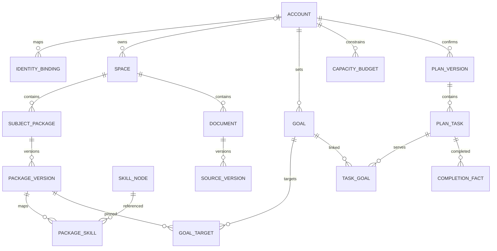

# CL-006a · 概念模型与字段字典

2026-10-13 · 设计提案；字段不是现有SQL。A主责、B复核待完成。

## 归属、学科与容量

账户保持稳定业务ID，认证供应商subject在IdentityBinding中映射，替换认证组件不更换业务归属。
私有空间按服务端账户归属授权；公共候选空间与发布空间分离。公共名称相同或文件哈希相同，
不会合并所有权。P0不引入机构/团队空间；公共编辑权限逐项授予，支持角色不自动取得私有读取权。

学科用通用SubjectPackage与SkillNode表示，408/CET/物理只作为样例数据，核心表没有科目专属列。
公共包引用已发布Release的确定版本；私有派生包保留自身space_id及公共来源版本，不复制公共编辑权限。
Goal可绑定多个包/技能；学习任务可关联多个目标。用户每天/每周的总容量按账户统一计，
不因目标跨学科而各给一份预算。每日与每周是可选约束，同时设置时两者均须满足。

时间段归属使用用户设置的IANA时区，按该时区生成半开区间[start,end)，时区更改只影响新计划。
完成事实使用实际UTC时刻及当时计划时区；不能挪动历史记录消除超额。未确认提案不占正式计划容量，
接纳新计划在同一事务替换未来未完成分配；已经完成的任务不被撤销计划或来源更正抹除。

## 字段字典

所有可授权实体有不可猜测ID，但授权仍查当前space/账户；ID不可猜测不作为权限控制。
涉及条件写入的聚合有revision整数，软撤回/访问阻断与物理清理状态分开。

| 实体 | 关键字段与约束 | 权威模块 |
| --- | --- | --- |
| Account | id、status、timezone、revision；认证状态与空间归属分开 | Identity/Access API |
| IdentityBinding | account_id、provider_config_id、provider_subject；二者组合唯一，密码由认证组件管理 | Identity API |
| Space | id、kind(private/candidate/published)、owner_account_id或受控编辑域、access_revision、access_state；private必须有唯一归属 | Access API |
| SubjectPackage | id、space_id、label、description_ref；名称不唯一、不产生跨域合并 | Catalog API |
| PackageVersion | package_id、version、release_id(nullable)、status、rights_snapshot_id；发布版不可原地改写 | Catalog API |
| SkillNode | id、namespace、label、version；通用公共节点与私有映射分开，私有内容不写公共节点 | Catalog API |
| PackageSkill | package_version_id、skill_node_version_id、mapping_revision；空间内可编辑映射 | Catalog API |
| Goal | id、account_id、space_id、label、priority、target_date(nullable)、revision、status | Learning API |
| GoalTarget | goal_id、package_version_id/skill_version_id、scope_ref；绑定指定版本及授权用途 | Learning API |
| CapacityBudget | account_id、period_kind(day/week)、timezone、period_start/end、minutes、revision；minutes为非负整数 | Planning API |
| PlanVersion | id、account_id、base_plan_id、goal/capacity/evidence_revision、status(proposed/confirmed/superseded/reverted)、confirmed_at | Planning API |
| PlanTask | id、plan_version_id、occurrence_key、window_start/end、estimated_minutes、resource_version_ref、purpose；同账户/计划occurrence_key唯一 | Planning API |
| TaskGoal | task_id、goal_id；组合唯一，不存第二份时间扣减 | Planning API |
| CompletionFact | id、task_occurrence_key、account_id、attempt_ref、completed_at、observed_minutes(nullable)；重复回执不重复完成 | Learning API |
| RightsSnapshot | id、resource_version_id、allowed_purposes、evidence_ref、review_state、revision；证据附件受控 | Rights API |

引用、解析、题目、作答和计划依赖字段见[CL-006b](versions-and-invalidation.md)。
账户删除与来源删除采用不同闭包；这里没有设定未经确认的个人数据保留天数。

## 容量计算与示例

一项15分钟任务同时服务英语与算法两个目标，TaskGoal有两行，但该occurrence只计15分钟。
再安排20分钟物理任务，总计35分钟；若日上限30分钟，提案显式冲突并等待用户调小/重排，
不能自动扩容、删除另一目标或把一个任务重复算两次。实际耗时用于后续提案，不倒改已确认历史估时。
容量限制的是用户安排，不等于模型token/GPU配额；后者由Job/费用模块单独管理。

公共包与私有包都叫“基础物理”时保留两个ID。新加经济学包只新增数据，不改核心schema。
用户引用公共发布P1后公共方发布P2，用户当前计划仍锁P1；更新提案展示差异并由用户确认。

## 条件写入

提交计划带base_plan_id、goal_revision、capacity_revision与evidence_revision。
API在账户/当前计划聚合锁内读取并比较；任一变化返回版本冲突与新快照，不覆盖另一个请求。
目标状态、来源可用用途、去重分配与总容量检查在同一接纳事务完成。
撤销计划生成一个新版本，重新挂接仍有效未来任务，并保留已完成事实，不回滚个人作答。
计划事务的接口与事件由CL-007/008定义，当前包未修改运行时。
