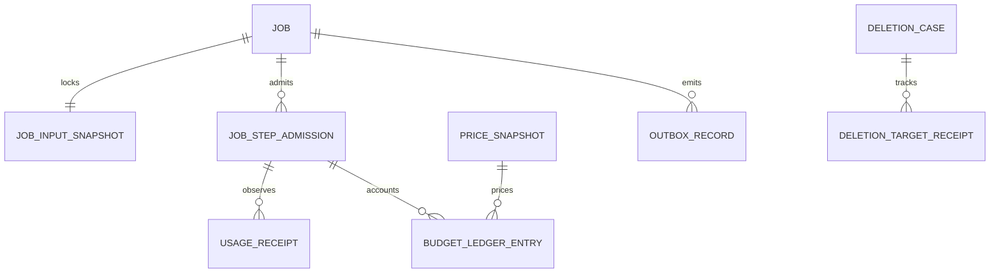

# CL-006c · 模块写入所有权、事务与迁移

2026-10-13 · A主责、B非作者复核待完成。主API是唯一业务事实写入入口；
本包没有创建下面的表、角色、接口或迁移文件。

## 写入矩阵

| 事实/资产 | 权威模块 | worker可做 | 同事务要求 |
| --- | --- | --- | --- |
| 身份/空间/授权修订 | Identity / Access API | 校验本次委托，不能创建用户/授予权限 | 邀请消费＋注册，授权撤销＋访问代更新 |
| 权利快照/公共发布 | Rights / Catalog API | 产出报告，无批准或公开发布权 | 来源版本＋许可修订＋发布状态 |
| 文档/解析/标准块/索引代 | Document API | 指定临时命名空间写候选与逐页manifest | 当前来源/删除条件＋接纳元数据＋active代切换＋Outbox |
| 题/讲解/答案/量规 | Content API | 按最小证据生成与校验，提交候选引用 | 用途/依赖/Job条件＋发布版本；不能自动给诊断资格 |
| 作答/评分/学习证据 | Learning API | 最小授权评分候选 | 原作答去重＋锁题/量规版本＋新评分/证据版本 |
| 目标/容量/计划 | Planning API | 生成差异提案，无确认权 | 基计划/容量/证据版本＋分配＋用户确认 |
| Job/步骤/费用/取消 | Job / Usage API | 上报步骤与usage，申请下一步骤 | 步骤准入＋预算预留＋当前取消/删除条件；接纳usage去重 |
| 删除水位/清理回执 | Governance API | 执行受限清理并报告副本回执 | 访问阻断＋删除范围＋取消/准入代＋Outbox |
| Outbox/审计 | 由对应API事务写入 | 消费已授权事件，传递最小元数据 | 与相应业务写入同事务，消费者按event_id去重 |

“模块”是同一NestJS API内的职责，不新增独立服务或第二业务数据库。
Python worker只持受限服务身份、Temporal存储权限和限定临时对象能力；无业务PostgreSQL写账号。
Temporal持久化编排进度，Redis保存可重建缓存/限流，费用与删除水位不只存在Redis/工作流history。

## 接纳与费用语义

步骤准入在权威事务中检查Job、访问/来源/用途版本、供应商批准配置与费用上限，
写唯一(job_id,step_key,attempt_no)准入记录和预留，再把最小调用配置交worker。
晚到usage可以用于对账，但不能给已取消/删除Job继续生成或发布的资格。
同一usage回执去重；缺回执/断流写unknown_pending_reconciliation，不记零或释放为免费额度。
缓存价格未知时已知部分与情景估算分开；费用计算Decimal，reasoning若含在output中不重复计费。
本轮合成探针只是观察与有界请求演练，业务账本/锁尚未实现。

| 新增逻辑记录 | 最小字段与约束 |
| --- | --- |
| JobInputSnapshot | id、job_id、schema_version、owner/space_id、source/content/rights/access revision集合、purpose、requested_pages、base_aggregate_revision；只保存引用/最小配置 |
| JobStepAdmission | job_id、step_key、attempt_no、admission_epoch、provider/model/template_config_id、input_snapshot_id、reserved_quote_amount、currency、state、admitted_at；步骤尝试组合唯一，不以workflow_id授权 |
| UsageReceipt | admission_id、receipt_key、provider_response_id_digest、input/output/cached/reasoning_tokens、received_at、state(observed/unknown/disputed)；receipt_key去重，缺usage不用零填充 |
| PriceSnapshot | config_id、currency、unit、input/output/cached_decimal、evidence_ref、effective_version；未报价缓存为空，与0不同 |
| BudgetLedgerEntry | account/period、admission_id、entry_kind(reserve/observe/reconcile/release)、amount_decimal、currency、price_snapshot_id、revision；保留未知在途预留及对账更正，不覆盖已确认旧记录 |
| OutboxRecord | event_id、type/version、aggregate_id/revision、resource_refs、occurred_at、publish_state；payload不含正文/凭据；消费去重另存consumer_id＋event_id |
| AuditRecord | operation_id、actor_ref、scope_ref、reason_code、state、timestamp、retention_policy_ref；最小元数据、按获批期限保存 |
| DeletionTargetReceipt | deletion_case_id、copy_kind、resource/version_ref、watermark、state(blocked/pending/confirmed/unknown)、receipt_ref、updated_at；未知供应商副本不填confirmed |

上述引用由API确定，receipt/state等逻辑词在CL-007/008正式契约定稿前不增加现有SQL枚举。

worker提交产物manifest，API再锁当前来源/访问/Job/发布聚合并核质量、版本、删除及准入代，
通过才注册正式产物及Outbox；拒收候选转清理清单。对象存储写入不能与SQL原子提交，
因此临时写→校验/登记→权威接纳→异步转正式/清理的状态必须可对账，不从文件存在判断已发布。
未完成对象不可被普通读取路径访问；故障恢复根据DB接纳记录决定继续登记还是清理孤立对象。

## jobs骨架的增量演化

现有[schema.ts](../../../apps/api/src/database/schema.ts)保留七个job_status，input/output为JSON，
workflow_id可空且唯一。不得假设历史行已经带空间归属或符合新载荷规则。

| 阶段 | 拟实施动作 | 验证/回退前提 |
| --- | --- | --- |
| M1扩展 | 新增账户/空间/来源等表；jobs增加owner/space、input_schema_version、input_snapshot_ref、revision、admission_epoch、idempotency_scope/key等可空列；新增步骤/费用/依赖/删除/Outbox表 | 旧健康工作流兼容；索引/唯一键按空间/账户/用途定义，不以哈希跨域去重 |
| M2盘点回填 | 报告历史行kind/JSON载荷与归属；可确认的健康烟测迁受控系统域，无证据业务行隔离而非猜owner；清理JSON中不准进入history/事件的正文 | 合成演练与实际数据盘点分开；无法回填的行不开放用户API |
| M3双读验证 | API新写引用载荷，新读对新schema；旧行仅受控运维/兼容路径；逐条确认引用、权限、唯一性及费用状态 | 不进行会暴露私有数据的全量双写；新业务事实只用一种权威路径 |
| M4收紧 | 合格业务kind要求owner/space/快照/版本非空，施加外键/复合唯一/同空间关系约束；系统健康kind明确例外 | 并发一码/重复步骤/版本冲突/越域/取消删除负例通过；验证后切换运行配置 |
| M5退出兼容 | 盘点无依赖旧消费者，归档或删旧payload列/兼容逻辑 | 在迁移窗口内保留向前兼容，最后一步按不可逆变更单独安排 |

同空间关系使用复合键/约束或受审事务检查保证，不能只靠ORM查询过滤。
SQL实现定稿前以约束清单审阅，不在本包提前写未经应用接口确认的生产DDL。
所有迁移先在隔离恢复副本预演，记录行数、外键、权限、耗时/锁、受控备份和回退条件。

## 回滚与恢复

应用回滚要求旧版本能识别/拒绝新schema载荷，不能让旧镜像绕过已生效的访问、费用或删除控制。
新列/表在回滚窗口保留，不自动执行破坏性down；不回滚删除水位、撤销状态或已确认费用。
工作流按固定worker版本与历史重放兼容性处理，不能仅回滚Python镜像就接管所有在途任务。
最新删除台账必须独立于旧恢复点可取得；隔离恢复→重放删除/访问阻断→核对费用/在途步骤→检查不可读→开放。
丢失Redis可重建；丢失DB/台账或上游调用状态未知时进入受限待对账，不无限重跑付费步骤。

B的复核材料必须包含[合成样例](examples.json)中的source_revision冲突和source删除传播两例，
注明实际审阅人/日期/问题/结论；自动脚本只辅助证据，当前没有补造非作者签审。
CL-007/008/013及相应实现卡接续接口、真实锁/事务、迁移与故障恢复验证。
