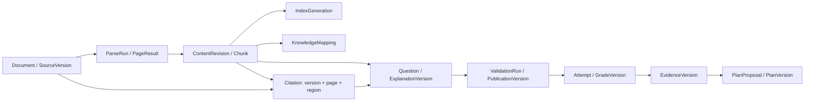

# CL-006b · 来源、题目、证据版本与失效传播

2026-10-13 · 设计提案；B主责、A复核待完成。
承接[数据目录D04–D23](../../security/CL-004/data-inventory-and-lifecycle.md)。

## 版本链与定位

箭头表示依赖，不意味着上游更正可以覆盖下游历史。所有生成/发布产物保留多来源依赖集合，
依赖边携带purpose与上游revision；发布时使用全部来源权限/用途交集，私有＋公共仍为私有。
索引是派生可重建数据，业务DB保存来源状态、发布索引代与清理台账。

| 实体 | 关键字段、唯一性及语义 |
| --- | --- |
| Document / SourceVersion | 稳定document_id、space_id；version_id、对象引用、sha256、pdf_page_count、rights_snapshot_id、state、source_revision。哈希仅完整性，不授予归属；新文件是新version |
| ParseRun | source_version_id、parser_config_id、model_revision、requested_pages、job_id、attempt_no、temporary_manifest_ref；重试不覆盖旧run |
| PageResult | parse_run_id＋pdf_page_index唯一；state(success/blank/failed/missing)、content_ref、quality_report_ref。请求页均有状态；空白页不同于失败/漏页 |
| ContentRevision | page_result_id、revision、author_kind(worker/user/reviewer)、base_revision、quality_state；人工纠错是新revision，原始解析保留受控追踪 |
| Chunk | revision_id、ordinal、tokenizer/model_config_id、token_count、span/region_ref；特殊token/前缀计入预算 |
| Citation | source_version_id、content_revision_id、pdf_page_index(从1)、printed_page_label(nullable)、region_id、bbox、coordinate_system、source_span/hash；不能只存模型随口给出的页码 |
| IndexGeneration | space_id、source_revision_set、embedding_config_id、dimension、chunk_policy_id、generation、state；API原子切换active_generation，禁止混合向量代 |
| QuestionVersion / ExplanationVersion | stable_id＋version、space_id、content_ref、blueprint/template/model_config_id、dependency_manifest_ref、purpose、quality_state；答案/量规单独版本 |
| ValidationRun | candidate_version_id、validator_config_id、local_checks_ref、verdict、reason_codes、review_ref；别名不同不自动等于独立模型，保留本地/人工证据 |
| PublicationVersion | candidate/answer/rubric版本、rights_revision、review_revision、release_scope(private/public)、published_at、state；诊断用途须额外达标 |
| Attempt / GradeVersion | account_id、question/answer/rubric具体版本、response_ref、hint/exposure_flags、submitted_at、grading_version、appeal_ref；复评分生成新版本，原作答事实不改写 |
| EvidenceVersion | attempt_id、grade_version_id、skill_mapping_revision、confidence/validation_state、purpose；未校验练习不自动成为强诊断证据 |
| DependencyEdge | downstream_resource_version、upstream_resource_version、purpose、upstream_revision；组合唯一，用于多来源闭包和接纳复查 |
| Invalidation / DeletionCase | case_id、scope、reason、watermark、access_blocked_at、copy_targets、receipts、cleanup_state；拒读、清理完成与未知副本分别记录 |

bbox使用明确的页内坐标系、页宽高与旋转；推荐规范化左上原点[0,1]矩形，保留到原解析坐标的变换。
印刷页码可为罗马字母/字符串，不充当PDF页序。引用回跳由API查版本授权后定位原件，
模型传回的来源编号必须映射到已授权Citation，不允许任意URL或跨空间对象键。

## 更正、撤回与删除

| 触发 | 当前生成/检索与未来计划 | 既有作答与证据 | 清理与访问 |
| --- | --- | --- | --- |
| 发布Source v2替代v1 | v1停止作为新任务current输入；下游标needs_review，重建新索引代；未来任务生成更新提案 | 锁v1的事实不被改写；证据标来源已变、暂停新诊断用途，复核后新证据版本 | 有权历史回跳可按用途继续；不默认v1立刻物理删除 |
| 人工修正某页ContentRevision | 依赖旧revision的题/讲解/索引失效；晚到旧revision结果拒收 | 原作答及旧评分保持；展示纠正/复评分，不以新答案偷偷覆盖旧判分 | 原解析与修订按获准范围保留，权限不放宽 |
| 来源撤回/用途撤销 | 立即阻断对应新生成/发布/检索；混合产物按用途交集重算，不因仍有另一来源就自动可用 | 事实与证据分离，证据不能继续驱动新诊断/计划；历史可读范围按撤回原因核验 | 移除索引/缓存，公共发布撤回；是否清除内容由权利决定 |
| 来源删除 | 先写权威阻断与删除水位，再取消相关Job/清理闭包；未来任务等待替代来源 | 清除原文/派生内容引用，最小事实是否可保留取决于Q04及用途；不给永久保留承诺 | 原件、历史对象版本、临时产物、索引、缓存、导出和供应商副本列清单，未知不记完成 |
| 账户删除 | 阻断该账户/空间及任务；公共来源不因某个用户删除被删掉 | 个人作答/目标/计划/证据纳入个人闭包；审计例外须有依据与期限 | 私有副本与各存储分别清理，备份到期和外部回执单列 |

Q04“保留学习事实与来源删除的冲突”仍待权利/隐私签审。设计先把内容副本与最小事实分开，
没有据此批准无限期保留、删后继续显示题干答案或恢复已失效诊断资格。

## 接纳原子性与竞态

Job输入快照锁具体source/content/rights/access revision集合，不只写current指针。
付费步骤准入及最终发布均由API在与取消/删除共享的权威锁/版本条件中复查。
锁顺序固定为账户/空间→排序后的来源聚合→Job→目标发布聚合；实际SQL锁与死锁重试由CL-008/实现卡验证。
source_revision、access_revision、rights_revision或Job准入代任一变更，拒收候选并登记临时产物清理，
不更新current来源、不发布索引，也不新增下一次付费修复。

删除事务提交阻断后，异步清理依赖闭包可分批执行；读/检索/下载仍查权威阻断，不能等扫描结束再拒读。
遍历去重并记录多来源与循环异常；来源删除无需删除其他仍有效来源，但混合派生资产必须阻断/重审。
Outbox仅承载引用、版本、操作类型与幂等键；CL-008负责事件重放和跨副本回执。

## 必须走通的例子

1. 生成锁source_revision=1，人工纠错提升到2；旧结果发布失败，用户看到版本冲突，不改写旧作答。
2. 删除S-A后，依赖S-A的块→索引→题→证据→未来计划全部被标记；共享另一来源S-B保留。
3. 来源含私有S-A及公共P1，发布域仍为S-A；无公共发布资格，不把题写进P1。
4. 恢复旧备份只得到旧内容，必须先取得独立最新删除水位、应用阻断并检查不可读；缺水位拒绝开放。

合成设计演练见[examples.json](examples.json)与[结果](example-results.json)；真实DB/对象/供应商清理待实施验证。
