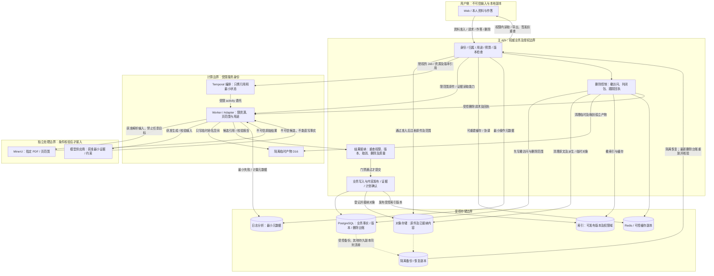

# CL-004a · 数据目录与生命周期

版本：0.2 · 2026-10-12 · **R0 设计交付已由 A（任宇航）验收；后续复核、签审与运行验证按父项记录接续。**

对应 CL-004a / #23；C 主责、A 复核，实际人员登记见 [父项入口](README.md)。
本稿覆盖已确认的完整 P0；规则是供后续实现评审的设计约束，不代表业务功能已上线。
与 [权限及素材权利矩阵](permissions-and-content-rights.md)、
[威胁模型及验证方案](threat-model-and-validation.md) 共同使用。

## 依据、现状和目录约定

依据：[P0 范围](../../product/CL-001a-scope-boundaries.md)、
[产品方案](../../CanLearn_Product_Plan_v2.1.tex) 的解析、编排、学习证据及治理章节、
[ADR-0001](../../architecture/ADR-0001-technology-stack.md)、
[ADR-0002](../../architecture/ADR-0002-repository-and-deployment-topology.md)。
2026-10-12 检查实际 [schema.ts](../../../apps/api/src/database/schema.ts)、
[初始 SQL](../../../apps/api/drizzle/0000_eminent_liz_osborn.sql)、
[API 模块](../../../apps/api/src/app.module.ts)、
[Python workflow](../../../apps/workflow/src/canlearn_workflow/workflows.py)/
[activity](../../../apps/workflow/src/canlearn_workflow/activities.py) 与
[Compose](../../../compose.yaml)：
只有 jobs 表、健康接口和健康工作流；没有用户/文档/来源/证据等业务实体或删除实现。
jobs 的 input/output 是通用 JSON，尚无资源权限、载荷最小化和删除规则的契约保证；
健康工作流仅返回服务状态，不证明真实文档载荷安全。Redis 本地配置启用 AOF，
因此不能把它当作只有内存的副本；生产持久化、备份及清理能力仍由选型决定。

- 敏感等级：**高**为身份、私有资料、个人学习及访问凭据；**受控**为内部操作/权利证据；
  **公开候选**仍受控，只有审核后的指定发布版本可公开。混合数据按最高等级处理。
- 权限域：`S` 为本人私有空间；`C` 为公共候选编辑域；`P` 为已发布公共版本；
  `O` 为受限运维/审计域。这些是逻辑域，不是已实现角色或组织空间产品。
- `API` 指主 API 的责任模块，负责权威状态、业务写入和发布；`W` 指受限 worker/Adapter，
  只能取得指定资源/版本的处理授权，写隔离临时产物，再向 API 提交接纳请求。
- 逻辑位置：`DB` PostgreSQL、`OBJ` 对象存储、`IDX` 检索索引、`TMP` 隔离临时存储。
  厂商、地域、固定期限、身份及索引方案未定，不从本地 Compose 推导生产决策。
- 最小归属/依赖元数据建议为资源 ID、权限域、来源版本/修订、用途、删除/撤回状态、
  产物依赖、Job/请求追踪和生成/审核版本；字段及状态枚举交 CL-006/007/008 定稿。
  派生资产继承所有来源的权限与用途交集；私有与公共混合产物仍为私有。

## 资产目录

访问列仅列需要某类访问的主体，具体操作条件由 004b 判定；支持人员不因此取得私有内容读取权。
下表全部业务资产为**规划**，D13/D14/D15 的“骨架”只表示已存在表/健康工作流/本地配置。
对外传输只限 004b 核验后的指定目的；不得将本目录视作私有资料已获外发许可。

| ID / 资产与目的 | 敏感 / 权限域与访问 | 权威写入 / 逻辑位置及副本 | 版本、依赖及传出边界 | 当前状态 |
| --- | --- | --- | --- | --- |
| D01 身份、账户、会话关联：认证及数据请求 | 高 / S；本人、API 身份模块 | API；DB，身份方仅必要关联 | 身份标识与分析标识分离；身份方条件 Q05/Q06 | 规划；身份方案未定 |
| D02 空间、资源归属：隔离与授权 | 高 / S/C/P；本人、API 权限模块 | API；DB | 由服务端确定归属；不信任客户端空间 ID | 规划 |
| D03 学科、目标、总容量与偏好：学习及排程 | 高 / S；本人、API 学习模块 | API；DB | 目标/容量版本；模型最多接收必要且获准的约束摘要 | 规划 |
| D04 原 PDF、文档/来源版本：阅读与处理依据 | 高或公开候选 / S/C；本人或获准编辑 | API 注册并接纳；OBJ 原件，DB 元数据 | 文件版本、页范围、D05；传给 MinerU 限本次范围，公开读取须 D23 | 规划 |
| D05 声明、许可快照、作者/合同及权利审核：用途准入 | 高/受控 / S/C/O；本人可见声明、指定权利审核者 | API；DB + 受控证据 OBJ | 绑定 D04/D10/D23 版本及具体用途；合同/身份附件不公开 | 规划；Q01/Q08 |
| D06 页图、原始解析 JSON/Markdown/图片：回跳与适配追踪 | 与原件同级 / 继承 S/C/P；获授权阅读者，W 限范围处理 | W 写 TMP，API 接纳并登记；OBJ | 精确 D04 版本、页及解析器版本；仅准许的解析/生成输入 | 规划 |
| D07 标准化块、质检、人工修订：确认可用范围 | 同来源 / 继承域；本人或获准编辑，API | W 候选、API 接纳/修订；DB + OBJ | D06 + 修订号；原始产物不被纠错覆盖，旧依赖标待复核 | 规划 |
| D08 分块、向量/搜索索引：权限内检索 | 同来源 / 继承域；API 检索，W 限范围构建 | API 发布索引版本；IDX，必要块 OBJ | D07/索引版本；向量也是派生资产，不允许跨私有域哈希复用 | 规划；Q06 |
| D09 知识/技能节点、映射和来源引用：组织及核验依据 | 公共节点或高 / P、S/C 映射；获授权阅读者 | API；DB | 引用锁 D04/D07 页/区域/修订；公共节点不能携带私有映射 | 规划 |
| D10 题、答案、讲解、量规、校验及内容发布版本：练习反馈 | 同来源/个人输入 / 继承域；本人或指定编辑，API | W 候选、API 门禁后发布；DB + OBJ | D07/D09/蓝图/模型/校验版本；供应商仅获准证据，不获写事实权 | 规划 |
| D11 作答、提示/看答案记录、判分、申诉与学习证据：事实及更新依据 | 高 / S；本人、API 证据模块；评分 W 最小输入 | API；DB；附件 OBJ | 锁题/答案/量规版本，区分原文副本与事实；处理删除冲突 Q04 | 规划 |
| D12 完成任务、计划版本、恢复提案及确认/撤销：近期安排 | 高 / S；本人、API 计划模块 | API 版本比较及事务提交；DB | D03/D11 版本、基计划；W 仅提案，撤销不抹去后续作答 | 规划 |
| D13 Job 输入/输出引用、状态、失败回执及事件/Outbox 副本：追踪及幂等 | 高/受控 / 继承域 + O；本人可见其任务，W 限委托 | API 权威 Job/事件；DB，传递副本另登记 | 指向 D04/D10/D12，不内嵌原文/凭据；workflow ID 不充当授权 | Job 表骨架；业务 API/事件未实现 |
| D14 Temporal history/activity/heartbeat、重试/失败及可见性载荷：持久编排 | 受控，误放内容则高 / O；受限 W/运维 | 工作流运行时写编排记录；Temporal 存储 | 仅资源引用、版本及最小状态；业务结果仍经 API 接纳；Q09 | 健康骨架；无业务载荷规范 |
| D15 Redis、浏览器/下载缓存及协调状态：加速与短期交互 | 同来源或高 / 继承域；API、本人客户端 | API 控制可重建缓存；Redis/AOF、客户端缓存 | 缓存键含权限域/版本；协调记录不当作业务事实；下发最小内容 | Redis 本地配置；业务缓存未实现 |
| D16 中间文件、失败/孤立产物及上传未完成对象：阶段计算 | 同来源 / 隔离的 S/C 临时域；指定 W | W 受限写；TMP/临时 OBJ | 绑定请求/Job/来源及清理清单；不能从临时路径绕过 API 展示 | 规划 |
| D17 导出包、打包中间文件及 manifest：本人可获数据副本 | 高或用途受限 / S/C/P；请求人按用途授权 | API 决定内容，W 受限打包后接纳；临时 OBJ | 数据快照/来源用途/导出版本；含原文即纳入来源删除闭包 | 规划 |
| D18 下载/导出签名凭据及签发记录：限时传输 | 高 / 继承域；API 签发给获授权人 | API 签发；凭据只在必要传输路径，DB 最小签发记录 | 绑定资源/版本/用途/过期；停止签发不等于撤销已签发凭据 Q07 | 规划；撤销能力未定 |
| D19 日志、追踪、分析事件和错误报告：诊断与指标 | 受控/可能高 / O；受限运维，匿名化聚合读者 | 各服务写最小元数据；受控日志/分析存储 | 禁原文、作答全文、答案、访问凭据；用户关联最小化；外部工具 Q05 | 仅运行基线；业务方案未定 |
| D20 最小费用/审计/删除台账：核对消耗及避免复活 | 高/受控 / O；本人可见必要回执，授权审计/运维 | API 权威台账；DB + 可供恢复核对的受控副本 | 操作/状态/范围/时间/计量，不复制内容；例外留存须依据及期限 | 规划 |
| D21 DB/OBJ/索引/Redis/Temporal/日志备份及恢复副本：灾难恢复 | 与被备份数据同级 / O；受限恢复人员 | 受控备份系统；隔离备份/恢复存储 | 备份时间、范围、到期规则及最新删除台账水位；不直接向用户开放 | 规划；Q03/Q06 |
| D22 MinerU/模型及分包方的输入、临时文件、输出、日志/副本：指定处理 | 同输入 / 独立供应商处理域；限定处理者 | 供应商仅处理，不写 CanLearn 事实；其受控存储 | 对齐资源/Job/调用；地域、留存、训练、分包、退出 Q05 | 未接真实资料；条件待审 |
| D23 公共候选审核、发布/撤回清单与署名：公开版本治理 | 候选受控，批准字段公开 / C → P；编辑/审校及公共阅读者 | API 在权利、质量、学科审校后发布；DB/批准 OBJ | D05/D07/D10 版本及用途；发布内容与内部审核附件分离 | 规划；Q01/Q08 |

## 数据流及信任边界

图中所有业务路径均为待实现设计。箭头只给指定目的与最小载荷；API 授权不能由
worker 的旧任务授权、供应商返回“成功”或对象路径存在替代。受控数据层不向浏览器或供应商开放。

D14 编排存储及 D22 供应商副本另行计入清理清单，不能从图中未连线推断无副本。
D18 若采用 API 授权的对象下载能力，浏览器只使用这次许可的资源；是否经代理下载、
能否即时撤销、过期上界及缓存策略由 Q06/Q07 确定，不能绕过后续访问门禁。

## 生命周期与清理闭包

以下阶段为语义约定，不新增数据库状态枚举；实体转换、事件和回执由 CL-006/007/008 接续。

| 阶段 / 触发 | 必须动作 | 禁止行为及后续核验 |
| --- | --- | --- |
| 准入 / 上传完成 | 核身份、资源归属、用途/权利、安全与配额；登记来源版本、全部页范围及副本清单 | 仅凭上传成功启动生成；未知外发条件自动转其他供应商 |
| 处理中 / 子范围产出 | 每次活动和外发前复查授权及删除/取消；候选进 TMP，保留成功/失败页范围 | W/MinerU 直接改来源可用状态、证据、计划或公共发布 |
| 可用 / 发布 | API 接纳时核当前版本和所有来源用途；按已验证范围发布索引/内容，记录依赖 | 失败页静默可用；从旧引用恢复已撤回内容 |
| 纠错 / 修订 | 新修订保留可追踪关系；旧分块/索引/引用及关联内容撤出新生成，标待复核 | 覆写原始解析；静默重写旧作答或把内容错误记成学习者退步 |
| 公共撤回 | API 停新访问/生成/导出与索引；同步撤回所有发布入口，通知依赖复核 | 撤回当作所有副本物理删除；以旧发布版绕过用途审核 |
| 取消 Job | 停止新增步骤和后续计费操作；请求在途取消，API 拒绝晚到发布；清临时资产 | 取消充当资料删除；删除既有有效事实；隐去已发生必要消耗 |
| 删除请求受理 | 校验范围，API 原子写删除记录并停止新访问、凭据签发、检索和任务；计算派生闭包 | 等后台清理完才限制访问；把任务 CANCELLED 当作所有副本已清 |
| 在线清理 / 重试 | 按下表逐存储、原文派生、临时、导出及供应商清理；失败留状态/范围并幂等重试 | 因对象不存在即结束其他副本检查；无限重试且无失败可见性 |
| 备份到期 / 恢复 | 按已批准规则清备份；恢复隔离、应用最新删除记录、重建干净索引及核验后开放 | 旧备份覆盖新删除台账；恢复 Temporal/Redis 后重放旧任务复活 |

删除/取消标记、新步骤准入与结果接纳须通过事务及版本条件协调，不能读到旧状态后
另行无条件启动付费步骤或提交。取消前已获准并发出的请求计为在途，记录必要消耗，
不承诺零上游费用；精确准入点、幂等和费用规则交 CL-008/114/115 定稿。

纠错后的旧版可保留受控历史回跳：本人/版本授权、来源用途有效且未撤回或删除时，
只用于核对历史作答及修订，不参与新检索/生成。撤回或删除后仅给允许的失效提示，
不得以历史入口恢复原文读取；具体题面/判分历史字段按 Q04 决定。

单文档删除以 D04 的所有版本、修订及依赖为根，包含 D06–D10 的原文衍生、
D13 的内容载荷、D15–D18/D22 的副本；混合来源产物先整体撤访问，只有重新生成并
独立证明不含被删内容/依赖后才能重新接纳。通用公共知识节点可保留，其私有映射应清理。
账户删除扩大到 D01–D03、该账户所有私有内容、D11/D12 及各副本，并向身份方请求清理。
公共内容的合同/作者权益与删除义务按 Q08 单独审查；不得因删除某编辑账户自动
保留其个人数据，或擅自删除独立权利主体的全部公共作品。

**历史事实与主动删除分别处理。** 纠错、恢复提案撤销不删除已发生作答和已完成任务；
这不构成文档或账户主动删除时永久保留个人数据的授权。建议文档删除后清原文、
题/答案副本和来源附件，仅对经 Q04 批准的本人历史事实保留最小记录及“来源已删除”提示，
相关诊断暂停或重算；账户删除默认清个人学习数据，只有已核验依据、范围及期限的
最小审计例外可留。具体字段、替代标识、判分依据及用户选择均是**候选规则，Q04 待决**。
实现与用户删除承诺前必须定稿；不能以事实不可变阻止删除，也不能留下可复原原文。

## 逐资产保留、删除、导出与证据

期限采用目的及触发条件设计；所有数值仍待 Q02/Q03/Q05/Q07/Q09 决定。
“有依据的最小保留”必须登记实际依据、字段、访问者和截止时间，未登记时不是例外。
导出须重新授权并按素材用途限制；不可导出的第三方全文可给允许的引用/来源导航。
证据只记录受控资源标识、范围、状态、计数、时间及必要校验，不把被删原文写入回执。

| 资产 | 保留触发 / 删除或撤回动作 | 本人导出范围 | 后续可核验证据与负责角色 |
| --- | --- | --- | --- |
| D01 | 账户有效期间最小认证数据；删除撤会话、解绑及请求身份方清理，例外待审 | 本人账户字段，不含密钥/会话令牌 | 会话失效与关联清单、身份方回执；A，Q02/Q05/Q06 |
| D02 | 有效空间/归属；删除撤成员与资源授权，保留防复活最小标识期限待定 | 本人空间及归属记录 | 无跨域读取/新授权、清理范围；A，Q02 |
| D03 | 有效目标及用户所需历史；账户/相应目标删除清个人设置和摘要副本 | 本人目标、容量及偏好 | DB/缓存/外发摘要核对；A/D，Q02 |
| D04 | 用户保存且用途有效；删所有原件版本/上传残片，公共撤回按用途复核 | 本人上传原件及允许的元数据 | 对象版本清单、不可读检查、清理回执；A/C，Q02/Q08 |
| D05 | 用途审核及争议处理需要；撤回后缩减至有依据最小记录，个人附件单独清理 | 本人声明/可提供的用途结论，不默认交付他人合同 | 用途版本/审核证据范围及到期记录；A/C，Q02/Q08 |
| D06 | 来源可用及必要溯源期间；随原件删页图/原始文本/图片等全部版本 | 本人解析产物，受相同用途限制 | 原件→产物 manifest、对象残留检查；C，Q02 |
| D07 | 有效修订及必要纠错历史；旧版停新生成，删源时清所有含原文修订 | 本人标准化内容、质检与修订记录 | 修订闭包、待复核清单及已清版本；C，Q02 |
| D08 | 可用来源版本；纠错先撤旧索引，删除清分块/向量/搜索副本并校验 | 允许的分块/索引元数据，不交付其他域索引 | 按 ID 与检索负例核对，重建不复活；C/B，Q02/Q06 |
| D09 | 节点有效期；删除私有映射、原文摘录/坐标依赖，引用显示失效 | 本人的映射/引用及许可允许的公开节点 | 引用不可回跳、未用于新生成，公共节点无私有内容；C/D，Q02 |
| D10 | 来源/用途有效且用户保存；纠错标复核，删源清原文派生或经独立复审重建 | 本人可获练习/反馈及版本/标识，答案按授权用途 | 题/讲解依赖闭包与发布撤回记录；C/D，Q02/Q04/Q08 |
| D11 | 学习目的所需事实；文档删除与账户删除分别执行获批字段规则，原文副本清理 | 本人作答、判分、申诉、证据及已失效标记 | 清理字段清单、诊断停用/重算、无原文残留；A/D，Q04/Q02 |
| D12 | 当前与必要历史计划；撤销只变未来，账户删除清个人任务/提案，含原文同步清 | 本人计划、差异、确认/撤销及完成记录 | 基版本冲突/撤销记录、删除字段清单；A/D，Q04/Q02 |
| D13 | 活动任务及必要诊断窗口；取消留最小状态，删输入/输出与事件副本中的内容载荷及无效引用 | 本人任务状态、范围与必要失败原因 | 幂等终止及晚到/事件重放拒绝记录、JSON 载荷检查；A/C，Q02 |
| D14 | 工作流必要运行/诊断窗口；清业务载荷及历史/可见性副本按支持能力设计 | 本人任务摘要，不直接导出内部 history | history/activity/heartbeat/failure/search attributes/memo 载荷与留存核查；C/B，Q09 |
| D15 | 可重建短期使用；失效广播与版本校验，清 Redis/AOF/服务缓存及可控客户端存储 | 无独立缓存导出，返回权威数据 | 缓存命中负例、AOF/快照清理策略；A/B，Q02/Q03 |
| D16 | 活动步骤所需；失败、取消、删除或失去依赖后按期限清理孤立对象 | 默认无，只有 API 接纳产物才可导出 | Job/来源归属及扫描清理计数，无路径直读；C，Q02 |
| D17 | 导出交付窗口；过期/撤用途/删源清包和打包残片，阻断新下载 | 就是获准数据副本，保留标识、来源和用途说明 | 打包 manifest、快照水位、包清理与重新授权；A/C，Q02/Q07 |
| D18 | 指定请求及有效期；撤授权停签发，按方案撤已签发凭据或跟踪残余至失效 | 不导出有效凭据 | 签发范围/到期和撤销能力验证，不记录凭据值；A/B，Q07 |
| D19 | 排障/指标最小窗口；删关联字段和误入内容，聚合须证明不含个人/原文可识别数据 | 可提供的本人相关记录，不泄他人或内部安全细节 | 日志脱敏抽查、关联删除及外部工具回执；B/A，Q02/Q05 |
| D20 | 核验目的且有依据的最小窗口；清内容与过多标识，删除记录至少覆盖可恢复副本窗口 | 本人必要费用/删除进度和可提供审计摘要 | 留存依据/字段/期限、计费去重、删除台账水位；A/B，Q02/Q03 |
| D21 | 已批准备份窗口；按到期/清理策略消除副本，恢复前重放最新删除记录 | 不以备份作为日常导出来源 | 备份范围/到期回执、隔离恢复与删除负例；B，Q03 |
| D22 | 供应商约定必要处理窗口；停止新传输，请求含分包/日志/备份的适用清理并跟踪 | 只交付平台已接纳且获准结果，不暴露供应商内部信息 | 请求/调用映射、供应商回执及尚无法证明的副本；C/A，Q05 |
| D23 | 有效公共用途及审核版本；撤回读入口/索引/缓存/导出，原件清理另按义务 | 仅许可允许的公开内容/署名/来源，审核附件受控 | 发布/撤回清单、入口一致性与用途复核；A/C/D，Q01/Q08 |

删除进度至少分别计量：请求已受理、API 及新签发已禁、在线各存储清理、在途凭据/缓存
残余、供应商请求/完成或待确认、备份清除及必要例外；不把“后台 Job 成功”统称为全链路完成。
合法内容缓存可以保存获批最小内容；Redis/AOF 等持久文件的逻辑失效、物理清理及恢复
清理分别核验，按 Q02/Q03 批准的期限和步骤留证，不承诺删除受理时所有旧字节瞬间清除。
Q07 未证明撤销能力前，不能承诺已签发 URL 立即不可读；需结合原件清理、访问方式和
明确有效期上界说明残余。已下载到用户设备、转存到平台控制外的副本不能宣称已被平台召回；
平台仍清自身及受控缓存。任何失败或未知副本应显示范围、下一次处理及升级责任。

恢复时先在隔离环境核对 D21 清单和删除台账的新鲜度；取得独立于旧恢复快照的最新 D20
删除记录，应用到 DB/OBJ/IDX/缓存/Temporal 重试与待接纳队列，核查再开放服务。
删除记录不可只和被恢复数据库共用一个旧快照；保存及可恢复窗口依 Q03 协调，
找不到最新记录或不能证明已应用时保持隔离。备份到期和供应商“已提交删除”分别记录，
不得冒充在线或供应商物理清理完成。

## 合成纸面推演记录

日期：2026-10-12；输入为人工构造的 Alice/S-A、Bob/S-B、两页原创 Doc-A v1/v2、
公共候选 Pub-C、任务 J1 和备份 B0；不含真实身份/资料，未调用接口、供应商或恢复环境。
下表是**规则推演与设计结论**，不是生产、安全测试通过或正式评审签字。

| 案例 / 明确输入 | 推演步骤 | 预期结果 / 本次设计结论 | 待真实验证 |
| --- | --- | --- | --- |
| A01 正常上传；Alice 的 Doc-A v1 两页，第 2 页公式质检失败 | API 准入→J1 限两页→W 临时写→API 接纳仅第 1 页→索引/学习候选 | 仅已确认页可生成；第 2 页显示失败，候选不能自动公开；目录 D04/D06/D07/D08/D13 足以记录范围 | CL-104/106/109/110 验页范围、接纳门禁和失败展示 |
| A02 纠错；Doc-A v1 第 1 页已生成题 Q1，Alice 已作答 | 建 v2 修订→撤旧索引新生成→Q1/讲解标待复核→保留旧版本作答→复核后重算 | 版本关系可追溯，诊断暂停或重算；不能覆写历史作答；D07/D10/D11 应分别有版本 | CL-006/113 与学习证据实现验证修订传播及计分 |
| A03 取消；J1 的 MinerU 请求在途，晚到结果 R1 | API 记取消→停新步骤/计费→R1 写临时→接纳复查拒绝→清孤立对象 | 取消不删除 Doc-A，也不发布 R1；已有必要消耗可核对；D13/D16/D20 分开 | CL-008/114 验重试/重复回执/费用去重和孤立清理 |
| A04 删单文档；Doc-A 有题 Q1、作答、导出 E1、缓存及旧签名 URL | 写删除记录→停检索/签发/任务→遍历依赖→清原文和 E1→请求供应商→按凭据能力计残余 | API 新访问应拒绝；D11 最小历史字段仍待 Q04，URL 残余仍待 Q07，不能宣称即时全清 | CL-103/110/117/118 全链路负例；Q04/Q07 定稿 |
| A05 删账户；Alice 有多个文档、计划及身份关联，Bob 独立持相同 PDF | 撤 Alice 会话/空间→清其私有闭包和个人学习数据→身份方请求→核 Bob 归属 | Alice 不再有入口；Bob 独立资源不因文件哈希误删或被复用泄露；审计例外须有依据 | CL-101/117/118 验多资源、身份方、共享底层引用与例外 |
| A06 恢复；B0 在 Doc-A 删除前，最新删除记录在恢复快照之外 | 隔离恢复→取最新删除水位→清 DB/OBJ/索引/AOF/工作流待重试→负例→开放 | Doc-A 无法回读/检索/重发；缺最新台账则保持隔离，D20 必须覆盖可恢复窗口 | CL-005d/117 恢复演练；Q03/Q09 明确保留与清理能力 |
| A07 导出竞态；Alice 请求 E1 后删除 Doc-A，Bob 猜 E1 ID | 打包起始及接纳/下载前重查→发现删除→清临时包；Bob 请求按实际归属拒绝 | 旧快照不恢复被删内容；公共候选/超许可全文不混入导出，内部日志及凭据不导出 | CL-007/110/116/118 验下载、导出快照和用途负例 |

纸面推演发现的决定项已登记到 [父项入口](README.md)：Q04 决定历史证据字段，
Q07 决定下载残余边界，Q03/Q09 决定恢复与编排留存，Q05 决定供应商可核验证据。
已有 A（任宇航）的 R0 设计验收；非作者及外部签审未完成。A01–A07 可作为下游用例输入，不能充当其执行记录。

## 接续条件与评审检查

- CL-005 选型须满足逻辑存储隔离、可枚举副本、凭据边界、退出清理及隔离恢复；
  Q05/Q06 未定不自动批准真实私有资料外发。期限 Q02/Q03/Q09 在相应配置及承诺前确定。
- CL-006 明确所有权、来源版本/依赖闭包、D11/D12 的 Q04 字段规则、D20 删除水位；
  CL-007/008 将服务委托、接纳复查、取消/删除和幂等回执写入 API/Job/事件契约。
- CL-101/103/104/109/110/114/116/117/118 及 R1B 学习实现按 004b/004c 接续；
  每次新增持久副本或外发目的须更新目录及删除/导出清单，避免默认沿用原权限。
- 下游实现评审须逐项复核 D01–D23、数据流、A01–A07 和待决负责人/节点，
  记录实际非作者审核人与意见。本卡已按父项中的用户指示完成 R0 设计验收，未新增业务或安全验收证据。
