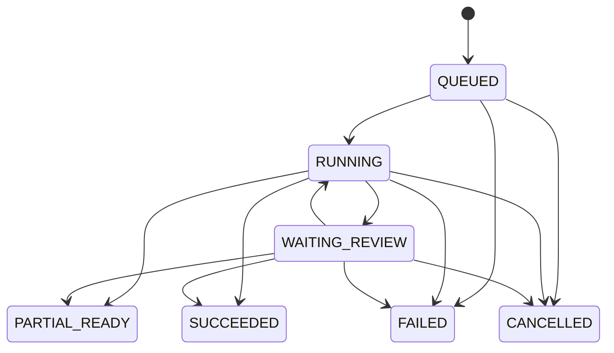

# CL-008a：Job 状态、快照与步骤准入

2026-10-13 · 冻结候选，A→B 非作者复核待补。保持现有 [jobs 七状态](../../../apps/api/src/database/schema.ts)，
不新增 SQL 枚举；[Job REST DTO](../../../contracts/openapi/canlearn.v1.yaml)仍为规划。

## 七状态与可达转换

| 当前状态 | 可达下一状态 | 条件与责任 |
| --- | --- | --- |
| QUEUED | RUNNING / FAILED / CANCELLED | API 接纳启动；准入永久错误/排队截止则 FAILED；取消/删除则 CANCELLED |
| RUNNING | WAITING_REVIEW / PARTIAL_READY / SUCCEEDED / FAILED / CANCELLED | 审核等待；有界尝试结束后的部分/全部结果；永久错误/截止；取消 |
| WAITING_REVIEW | RUNNING / PARTIAL_READY / SUCCEEDED / FAILED / CANCELLED | 审核通过且快照未变才继续；已有候选按规则结束；拒绝/截止；取消 |
| PARTIAL_READY / SUCCEEDED / FAILED / CANCELLED | 无 | 终态不复活；重复完成只核对同一回执；显式重试建新 Job |

RUNNING 可展示已获权威接纳的子范围；**PARTIAL_READY 表示本次有界尝试已结束**，有至少一个可用结果，
其余请求范围都有 failed/missing 等明确状态。它不表示后台还在无限重试。
需要人工审核的候选只在受控审核入口可见；WAITING_REVIEW 不授予公开发布或诊断资格，
必须有审核期限和明确责任，逾期可 FAILED/REVIEW_DEADLINE，不永久挂起。
部分结果须满足对应用途质量门；不得因为解析有文本就给学习/诊断可用标记。

每个请求页必须有 success/blank/failed/missing 状态且页集合恰等于快照请求范围，重复/越界拒收。
全 blank 可解析 SUCCEEDED，但可学习范围为 0；全失败为 FAILED；有成功且有失败/缺页为 PARTIAL_READY。
成功页＋空白页且没有失败为 SUCCEEDED。生成/校验等 kind 采用各自强制结果清单与质量门，
不能把本包的页状态规则当作全部模型任务规则。

终态后新增 usage/清理回执可更新费用/清理子记录与 Job revision，但不改变本次执行终态。
来源后续删除不把历史 SUCCEEDED 改为 CANCELLED；读/检索/生成查当前阻断状态，旧产物立即不可读。
取消前已接纳的合格部分结果仍可在当前授权内读取；取消后新增候选禁止接纳，
用户如需删除已存在内容，应走单独删除协议。

## 业务标识与幂等

| 标识 | 权威/组合与规则 |
| --- | --- |
| job_id | API 创建稳定 UUID；用户查询和取消只认业务 Job，不认上游任务 ID |
| 请求作用域 | 已认证 actor＋服务端确认 space＋operation＋目标资源/父 Job；同键不得跨权限域共享 |
| 请求指纹 | 原始语义 DTO 的固定序列化：明确输入版本/页范围/参数/用途/父 Job；不把会变的 current/访问修订指针重新散列成旧请求 |
| input_snapshot_id | 服务端首次受理锁定 source/content/rights/access revision、配置与用途、请求范围；后续执行不覆盖 |
| workflow_id | 固定 `cl-job/<job_id>`；namespace/worker 配置单独存受控配置引用，不暴露给普通客户端 |
| run_id / activity attempt | 编排诊断与尝试映射；不是业务授权或付费步骤键；重试/Continue-As-New 不建第二个业务 Job |
| step admission | UNIQUE(job_id, step_key, attempt_no)＋input_snapshot_id/config_id/admission_epoch；不同配置同组合冲突 |
| upstream_task_id | 按 admission 记录 provider/config、上游实例启动代、task/response ID 或受控摘要；不单靠进程内任务索引 |
| publication / usage | 目标版本/接纳键唯一；usage 按 admission＋稳定供应商回执标识归一化去重，不用每次 HTTP 投递的新 ID |

重复相同请求返回同 Job，包括已结束 Job；每次重放响应先校验当前权限/删除状态。
同作用域同键异 DTO 为 CL-007 `409 IDEMPOTENCY_KEY_REUSED`；修订/权限变动不会偷偷替换旧快照。
记录有效期与清理期限由 Q02 决定；活跃、未知费用、删除/恢复待对账的键不能自动过期，
到期不是新一次调用的授权。实际 SQL UNIQUE、竞争失败后查询赢家与响应保存需 CL-105/114 实测。

用户重试仅在明确可重试 FAILED/PARTIAL_READY、费用/执行状态已对账且当前资源仍授权时创建新 Job，
锁新的快照并带 retry_of_job_id；只重跑失败子范围，不覆盖原成功记录。
永久错误、未知上游调用、来源版本冲突不自动重跑；冲突需要用户刷新来源，未知需人工/供应商对账。
同键再次点击“重试”仍返回同一重试子 Job。

## 权威事务与外部执行

API 使用 CL-006 的账户/空间→排序来源→Job→目标聚合锁序；步准入、取消/删除、候选接纳共享
同一来源/Job 版本条件。CPU/GPU worker 只提交最小引用/回执，不直写业务 DB。

1. 受理：检查权限/用途/输入版本/额度，保存不可变快照、QUEUED、幂等映射、`job.accepted.v1` Outbox，
   同事务提交。HTTP 返回 202 不等于 workflow 已启动；dispatcher 启动失败可查询/告警，不丢 Job。
2. 步准入：再核 current 来源/访问/权利、非终态、取消标志、admission_epoch、供应商配置与预算；
   唯一步骤与费用预留同事务提交。普通 HTTP/Temporal 重试只能领原准入，不能默默增加 attempt_no。
3. 发起外部调用：持久化 dispatch_intent 后调用上游。该写入和网络不能原子化；发送前/后崩溃都可能未知。
   原步骤没有已验证的上游幂等契约时默认不自动重复付费提交；查询/轮询可按有界策略重试。
4. 接纳：worker 写不可公开临时对象，再给 API 候选 manifest。API 锁定当前版本/权限/准入代，
   校验页覆盖/质量/资源归属，唯一接纳结果、更新终态和 Outbox 同事务；失败回滚不得留下可读结果或完成事件。
   SQL 与对象存储不原子：只由 DB 注册的合格对象可读，孤立临时对象登记清理，不从文件存在判断发布。
5. usage：单独验证回执来源、步骤与去重键。已取消/删除 Job 可记已发生费用，无生成/发布资格。
   同键异金额/用量保留已确认记录并置 disputed/待对账，不覆盖、不新增第二次扣额。

取消事务先置 cancel_requested、提升 epoch、逻辑终态 CANCELLED 并写取消/终态事件。
实际进程停止、临时清理、外部收费分别有 requested/confirmed/unknown 回执；HTTP 成功不证明物理停止或退款。
已终态取消幂等返回当前状态。取消先提交则晚到接纳失败；接纳先提交则保持其既有事实，
取消阻断后续步骤。删除事务先设来源/账户拒读和水位，再取消活跃 Job；闭包扫描可异步，
读路径立即查询权威阻断，不能等清理完成或缓存事件到达。

4070 中央执行器的进程台账/停止回执与 Job 准入关联；租约到期或 worker 心跳中断不证明 GPU 已释放。
旧进程未确认停止前不能准入下一重执行；也不能用队列各自并发 1 替代跨 worker 互斥。

## Temporal 与需要对账的状态

Temporal 在超时后按 Retry Policy 重试 activity，取消由 heartbeat 协作传递；
据此不能推定旧 HTTP/GPU 进程已停止或外部恰好执行一次。
[官方 Activity Execution](https://docs.temporal.io/activity-execution)的超时/取消机制是本设计的依据；
费用未知、步骤准入和停止回执是 CanLearn 另外需要实现的控制。

自动重试候选：读取、权限查询、原 Job 状态、上游轮询、同一回执提交，退避与总截止明确。
付费创建、重新解析、模型修复默认单次提交；SDK 自动重试关闭，只有供应商幂等/缺调用证据及新准入
经过验证后才允许显式重试。worker 重启从业务 admission/回执查询继续，不从空的本地缓存推断任务未执行。
仅 heartbeat 保存已完成步骤引用/计数，不放原文、完整响应、凭据或签名 URL。

超时/上游索引丢失达到有界截止：FAILED＋`UPSTREAM_OUTCOME_UNKNOWN`（内部事件 failure_code=`UPSTREAM_UNKNOWN`）、
cost_state=unknown_pending_reconciliation、retryable=false；在途预留保留，人工对账入口与责任告警可见。
失败不能计零；已知 usage 后也要确认实际停止/任务映射，再由 API 允许新的显式尝试。
审核等待用有限 signal/update 等待策略；收到信号仍复查 API 快照。重放兼容与 worker 版本策略交 CL-013/114 实测，
不因健康 workflow 成功声称业务编排已验收。
